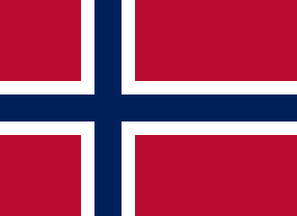

# Норвегія

Варіант № 10

*Номер варіанту: `ord("Y") % 10 + 1 = 89 % 10 + 1 = 10` - Норвегія.*

---

## Загальна інформація

Норвегія (*Norge*) - країна на заході Скандинавського півострова. Межує зі Швецією, Фінляндією та Росією, із заходу її береги омиває Норвезьке море, з півдня - Північне. Столиця - **Осло**.

<table border="1" cellpadding="8">
<tr><td>
Площа країни - 385 207 км² (разом зі Шпіцбергеном і островом Ян-Маєн), населення - близько 5,6 млн осіб. До ЄС Норвегія не входить, хоча референдуми про вступ проводилися у 1972 і 1994 роках.
</td></tr>
</table>

### Прапор

---

## Основні дані

| Показник | Значення |
| --- | --- |
| Площа | 385 207 км² |
| Населення | близько 5,6 млн осіб |
| Форма правління | конституційна монархія |
| Король | Гаральд V (з 1991 р.) |
| Прем'єр-міністр | Йонас Гар Стере (з 2021 р.) |
| Столиця | Осло |
| Офіційна мова | норвезька (букмол і нюношк) |
| Валюта | норвезька крона (NOK) |

Парламент Норвегії називається **Стортинг**. У ньому 169 депутатів, яких обирають на 4 роки. Король виконує переважно представницькі функції, а уряд очолює прем'єр-міністр.

---

## Природа

Найбільше Норвегія відома фіордами - вузькими морськими затоками з високими скелястими берегами.

- Гори і льодовики
  - найвища гора - Галлгопігген, 2469 м;
  - вона розташована в гірському масиві Ютунхеймен;
  - найбільший льодовик материкової Європи - Йостедалсбреен.
- Фіорди
  - Гейрангер-фіорд і Нерей-фіорд внесені до списку ЮНЕСКО;
  - найдовший - Согне-фіорд, приблизно 204 км.
- Північ
  - за полярним колом влітку сонце не заходить за горизонт, а взимку видно північне сяйво.

---

## Пам'ятки

1. **Брюгген** у Бергені - старі дерев'яні склади німецьких купців, об'єкт ЮНЕСКО.
2. **Ставкирка в Урнесі** - дерев'яна церква, збудована у XII столітті.
3. **Рьорос** - колишнє гірниче містечко, теж під охороною ЮНЕСКО.
4. **Наскельні малюнки в Альті** - петрогліфи, найстарішим близько 6000 років.
5. **Пульпіт** (Preikestolen) - скеля-обрив заввишки 604 м над фіордом.
6. **Атлантична дорога** - міст, який з'єднує острови над відкритим морем.

---

## Відомі люди

- Література і музика
  - **Генрік Ібсен** - драматург, автор «Лялькового дому»;
  - **Едвард Гріг** - композитор, писав музику до драми «Пер Гюнт»;
  - *Кнут Гамсун* і *Сігрід Унсет* - лауреати Нобелівської премії з літератури.
- Живопис
  - **Едвард Мунк** - автор картини «Крик».
- Дослідження
  - **Руаль Амундсен** першим дістався Південного полюса у 1911 році;
  - **Фрітьоф Нансен** - полярний дослідник, пізніше дипломат;
  - **Тур Хейєрдал** - переплив Тихий океан на плоту «Кон-Тікі».
- Спорт
  - **Магнус Карлсен** - чемпіон світу з шахів;
  - **Ерлінг Голанд** - футболіст, нападник збірної.

---

## Економіка

Головні галузі - нафта і газ (видобувають у Північному морі), рибальство та гідроенергетика. Майже всю електроенергію країна отримує на ГЕС. Гроші від продажу нафти держава не витрачає одразу, а складає у фонд на майбутнє, тому Норвегія має великий запас коштів.

---

## Фото

Гейрангер-фіорд. Більше фото можна подивитися [на Unsplash](https://unsplash.com/s/photos/norway).

---

## Висновок

Норвегія - країна з невеликим населенням, але дуже різноманітною природою і сильною економікою. Найбільше мене здивувало, що вона двічі відмовилася від вступу до ЄС, хоча за рівнем життя є однією з найкращих країн Європи.

## Джерела

- [Норвегія - Вікіпедія](https://uk.wikipedia.org/wiki/Норвегія)
- [Statistics Norway](https://www.ssb.no/en)
- [Стортинг](https://www.stortinget.no/)
